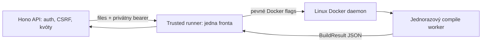

# WS-4 — izolovaná compile-only kompilácia

Stav: implementácia na vetve `codex/ws4-sandbox-isolation`, pripravená na kontrolu.
Produkcia sa v tejto fáze nemení. Výsledky reálnych testov sú uvedené nižšie.

## Zapojenie a hranice dôvery



- `/api/sandbox/build` aj počiatočný build a každý rebuild v `autofixLoop`
  používajú tú istú inštanciu `SandboxExecutor`. V izolovanom režime všetky
  požiadavky smerujú do jedného runnera a jeho spoločnej fronty.
- API má svoje existujúce AI/auth/OAuth credentials. Nedostáva Docker socket
  ani nové host bind mounts. Worker nemá tieto credentials, runner token,
  session volume, databázu, host adresáre ani Docker socket.
- Len **dôveryhodný runner** má prístup k Docker daemonu. Docker socket je
  administrátorské oprávnenie nad daemonom; samotné `cap_drop` tento fakt nemení.
  Preferuj vyhradený rootless daemon pod samostatným účtom. Rootful daemon na
  zdieľanom hoste znamená podstatne širšiu dôveru v runner a host kernel.
- Runner prijíma iba `POST /v1/compile` s presným JSON `{files:[{path,content}]}`.
  Neprijíma image, shell, command, mounts, flags, časové ani resource limity.
  Image je nastavený prevádzkovateľom a pri pripravenosti pripnutý na image ID
  počas života runnera. Zmena tagu za behu nezmení používaný image.
- `builder.ts` je čistý compile adaptér. Virtuálny FS, whitelist React importov,
  existujúca CSP, 40 súborov, 200 kB/súbor a 2 MB zdrojov ostávajú zachované.
  Používateľské `package.json` nespúšťa install ani scripts. Generované JS sa
  v serveri ani workeri nevyhodnocuje. Výsledné HTML beží až v klientskom iframe.
  Spoločná validácia je v `policy.ts`; diagnostika sa redaktuje pred skrátením.

## Vynucované limity

| Vrstva | Nastavenie |
|---|---|
| Každý worker | nový kontajner, UID/GID 65532, `--init`, bez privileged |
| Sieť / filesystem | `--network=none`, `--read-only`, žiadne bind mounts/volumes |
| Dočasný priestor | `/tmp` tmpfs 32 MiB, noexec/nosuid/nodev, mode 0700 |
| Pamäť | `--memory=256m --memory-swap=256m` (swap navyše 0) |
| CPU / procesy | `--cpus=0.5 --pids-limit=128` |
| Oprávnenia | `--cap-drop=ALL --security-opt=no-new-privileges:true`, default seccomp |
| Čas | controller watchdog najviac 20 s vrátane create/start; poistka workera 18 s od štartu Node |
| Výstup | stdout JSON max 8 MB, stderr max 16 KiB, bundle max 2 MB, výsledné HTML max 3 MB |
| Fronta | 1 aktívny build, najviac 8 čakajúcich, čakajúca úloha max 30 s |
| Runner overlay | 192 MiB RAM, 0.25 CPU, 64 PID, readonly root, tmpfs 16 MiB |

Docker CPU limit je kvóta, nie rezervácia CPU ani záruka latencie. Tmpfs sa tiež
počíta do pamäťového limitu workera. Pre API, databázu, daemon a existujúce služby
treba ďalšiu rezervu. Samotný worker + runner môžu spotrebovať približne 448 MiB
RAM a 0.75 CPU; obrázky, vrstvy pri builde a Docker metadata potrebujú disk.
Zdieľaný VPS 1 vCPU / 2 GB / približne 87 % disku nie je týmto taskom kapacitne
schválený. Obrazy zostav mimo VPS, pred nasadením zmeraj aktuálnu rezervu.

Watchdog zabije celú CLI process group a `finally` vykoná `docker rm --force`
presne pomenovaného UUID workera. Docker tým ukončí aj potomkov v kontajneri.
Následný inspect musí potvrdiť neprítomnosť; slot sa drží až do dokončenia cleanupu.
Cleanup má tri ohraničené pokusy. Ak neprítomnosť nemožno potvrdiť, runner sa
zablokuje. Rovnako sa zablokuje pri neurčitom výsledku `docker create` (daemon
mohol požiadavku dokončiť po CLI timeoute). Zrušenie počas create počká na jeho
ohraničené dokončenie a worker už nespustí.

Pri studenom štarte runner odmietne readiness, ak existuje ľubovoľný kontajner
s labelom `lov-devil.sandbox=ws4`. Tým nevytvorí súbeh so starým orphan workerom.
Spúšťaj iba jeden runner pre daný worker daemon; fronta nie je distribuovaný lock.
Úplný výpadok daemonu/hosta znemožňuje potvrdiť cleanup. Poistka Node je druhá
vrstva, nie náhrada za dostupný riadiaci daemon. Po takej udalosti treba zásah
operátora, kontrolu našich označených kontajnerov a reštart runnera.

HTTP vstup je max 13 MB (JSON escaping 2 MB zdrojov), naraz max 26 MB prijímaných
bajtov, max 8192 chunks/request a 12 spojení. Čítanie tela má watchdog 10 s.
Po pripojení do fronty zostávajú iba validované súbory. Kompresia vstupu sa
neprijíma. Runner chyby nezverejňujú stdout/stderr, interné cesty ani credentials.

## Konfigurácia a pripravenosť

| Premenná | Význam |
|---|---|
| `SANDBOX_MODE=isolated` | predvolený režim aj pri nezadanej premennej; bez platného runnera fail closed |
| `SANDBOX_RUNNER_URL` | privátna HTTP(S) origin s `/`, bez hesla, query alebo fragmentu |
| `SANDBOX_RUNNER_TOKEN` | nezávislý random bearer, 32–256 znakov `A-Za-z0-9_-`; len API a runner |
| `SANDBOX_MODE=host` | iba vedomý lokálny vývoj, bez hard resource limitov |
| `SANDBOX_WORKER_IMAGE` | dôveryhodná konfigurácia runnera; default `lov-devil-sandbox:ws4` |
| `SANDBOX_RUNNER_BIND/PORT` | runner default `127.0.0.1:8790`; v kontajneri bind `0.0.0.0` |
| `SANDBOX_DOCKER_SOCKET` | host socket iba pre compose trusted runner, default `/var/run/docker.sock` |

`npm run server:dev`, `server:mock`, `server:e2e` volia host režim explicitne.
Bežné `npm run server` ho nepredpokladá. Výpadok izolovaného runnera nikdy
nevyberie host builder. Konfigurácia sa nezapisuje do VITE premenných.

- `/api/health` ostáva liveness kontrolou; následná auth oprava pridala
  `auth:'enabled'|'disabled'` pre jednoznačné rozpoznanie pilotného režimu.
  Tento marker nie je readiness dôkazom kompilátora.
- `/api/sandbox/ready` vracia `{ready,mode}`, HTTP 200/503 a dedí existujúcu auth.
- Privátne `GET /ready` na runneri vyžaduje bearer a vracia readiness + stav fronty.
  Overuje Linux, podporu RAM/swap/CPU/PID limitov, worker image a cold-start orphans.
- `sandbox_busy` / `sandbox_queue_timeout`: 429; `sandbox_timeout`: 504;
  `sandbox_aborted`: 408; neplatný/veľký výstup: 502; unavailable/worker/cleanup: 503.
  Oprávniteľné chyby kompilácie ostávajú pôvodný `BuildResult` s HTTP 200.
- Hodená infra chyba zastaví autofix pred ďalším AI volaním. Zachované sú auth,
  CSRF, rate limiting, budget release, SSE generovania aj production guardy.

## Overenie na oddelenom Linuxe

Predpoklady: Linux Docker s vynucovanými cgroups (overené cgroup v2), Node podľa
projektu, npm dependencies z `package-lock.json`, testovací daemon bez WS-4 úloh.
Node 26.13.0, esbuild 0.28.2, React/ReactDOM 18.3.1 v overenom obraze zodpovedajú projektu a lockfile.
Žiadny obsah `.env` sa do testovacieho prostredia neprenáša.

```sh
npm ci --include=dev --ignore-scripts --no-audit --no-fund
MISTRAL_API_KEY= npm run typecheck
NODE_ENV=test MISTRAL_API_KEY= npm test -- --exclude '**/liveSmoke.test.ts'
MISTRAL_API_KEY= npm run build

# Najprv vyber neprodukčný Docker context/DOCKER_HOST!
SANDBOX_TEST_DAEMON=1 bash deploy/test-sandbox.sh
```

Posledný príkaz zostaví worker, runner a päť testovacích obrazov. Integračné
testy sú v bežnej sade preskočené; explicitný `SANDBOX_DOCKER_E2E=1` ich zapne.
Harness má scenár zapečený v dôveryhodnom testovacom image; produkčný protokol
žiadny scenár ani ľubovoľný príkaz nepozná. Testy kontrolujú vlastný label set
pred a po každom scenári a nemažú cudzie kontajnery ani obrazy.

**Výsledky 5. 11. 2026:**

| Kontrola | Výsledok |
|---|---|
| TypeScript / produkčný build | úspech; build zahŕňa `tsc --noEmit` |
| Lokálna sada bez live smoke / bez živého Mistral kľúča | 419 passed, 10 skipped (9 Docker + 1 pôvodný skip), 28 úspešných súborov |
| Reálny Linux, rootless Docker 29.1.3, cgroup v2 | **9/9 passed**, 28.62 s celého Vitest behu |
| API → bearer runner → worker | úspešný React build; CSP a diagnostika zachované |
| Kernel/OS dôkazy z workera | UID 65532, memory.max 268435456, swap.max 0, CPU quota/period 0.5, pids.max 128, tmpfs 33554432 |
| Izolácia | iba loopback, sieťové spojenie zamietnuté; root mount `ro`; CapEff 0, NoNewPrivs 1, seccomp 2; bez socketu/host mountu/app credentials |
| Hang a potomok | potomok potvrdený cez Docker top; watchdog 5 s v teste, následný force remove a prázdny worker set |
| OOM / veľký output / chybný JSON / cancellation | očakávané bezpečné chyby, cleanup potvrdený pri každom scenári |
| Výsledný runner image | skutočne spustený s readonly root, limitmi, privátnym socketom; readiness a reálny build prešli |
| Compose overlay | `docker compose … config --quiet` prešlo s dočasnou testovacou konfiguráciou |
| Zvyšné testovacie kontajnery | žiadne worker ani runner-test kontajnery; ostatné dev kontajnery bez zásahu |

Overené worker image ID:
`sha256:cd30990c9323d008f9c562c6206ed37c553b8729a34913bbcd20abb9f175d0ce`.
Runner image ID:
`sha256:60faabb562020e0a5cddd1f3895ee267ff9f305c3c1694bad6834589fd5616d0`.
Tieto IDs sú lokálne artefakty testovacieho daemonu, nie publikované registry images.
Podrobný Docker log zostal na testovacom Linuxe v
`/home/vorkei/.cache/lov-devil-ws4/run-20261105/verified-docker-complete.log`.

**Následné overenie s funkčnými šablónami:** rozšírená sada prešla **21/21**
na tom istom oddelenom rootless Linuxe (58.78 s), vrátane pôvodných deviatich
izolačných scenárov a dvanástich kompletných React projektov. Resolver teraz
podporuje parent-relative importy v rámci virtuálneho koreňa. Nový worker ID:
`sha256:f206fa62bd15e14aae0d29076f339a03872ff3c922e13139b87d433125900af0`.
Runner ID ostal rovnaký. Nový log:
`/home/vorkei/.cache/lov-devil-backlog/run-20261105/docker-final.log`.
Vyššie pôvodné worker ID patrí prvému WS-4 behu. Aktuálne výsledky ďalších
zmien uvádza `docs/WS-3-TEMPLATES.md`. Produkčný deploy sa nevykonal.

Zmenené časti: `server/sandbox/{policy,errors,queue,command,dockerCompiler,executor,runner,worker}.ts`,
compile adaptér `builder.ts`, API `server/index.ts` a `server/agent/autofix.ts`;
Dockerfiles/compose overlay/test script a env vzory v `deploy/` a `server/`;
explicitný host režim dev npm scripts; päť nových unit súborov `sandbox-*.test.ts`,
upravené existujúce autofix/hardening testy, `tests/integration/sandboxDocker.test.ts`
a testovací harness v `tests/fixtures/sandbox/`. Backlog a tento runbook uvádzajú
iba skutočne overený rozsah. Pôvodná oprava GitHub exportu, `docs/todoerik.md`
a prevádzkové skripty boli zachované bez ďalšieho zásahu.

## Budúce nasadenie — samostatné schválenie, v tejto fáze nevykonané

1. Skontroluj aktuálnu kapacitu, bezpečný testovací build a existujúce DB zálohy.
   Zaznamenaj presné staré API/runner/worker image IDs a privátnu konfiguráciu.
   Nový checkout/release zachová `.env`, PostgreSQL, session volume aj zálohovacie
   skripty; neprepisuj ich zo vzorových súborov.
2. Zostav obrazy cez príslušné Dockerfiles na build hoste a prenes overené image
   IDs na cieľový worker daemon. Tag `lov-devil-sandbox:ws4` musí existovať pred
   štartom runnera (`--pull=never`). Nikdy nenasadzuj testovacie harness images.
3. Priprav oddelený súkromný env súbor runnera (0600) obsahujúci iba nový runner
   token a dôveryhodné nastavenia image/bindu. Ten istý nový token pridaj API;
   existujúce Mistral/JWT/GitHub hodnoty nemeníš. Runner nesmie dostať API `.env`.
4. V testovacom compose prostredí použi oba súbory:

   ```sh
   cd deploy
   docker compose -f compose.yaml -f compose.sandbox.yaml build app sandbox-runner
   docker compose -f compose.yaml -f compose.sandbox.yaml up -d sandbox-runner
   # Až po successful readiness spusti/aktualizuj app v tomto staging projekte.
   docker compose -f compose.yaml -f compose.sandbox.yaml up -d --no-deps app
   ```

   Token dodaj privátne cez deploy `.env`/secret manager; netlač resolved compose
   config do logu. Runner nemá publikovaný port. Socket je namountovaný iba jemu.
   API je na existujúcej sieti aj na internej `sandbox-control` sieti.
5. **Súčasný VPS používa samostatný API kontajner + nginx + `lov-net`, nie tento
   vzorový web compose.** Nespúšťaj tam celý compose (kolidoval by web a chýbalo by
   existujúce DB zapojenie). Pri samostatnom budúcom deployi vytvor internú
   `lov-sandbox-control` sieť, pripoj do nej iba runner (alias `sandbox-runner`)
   a API. API zároveň ponechaj v `lov-net`, s pôvodným portom, pamäťovým limitom,
   auth env a `lov-devil-sessions:/data/sessions`. Runner flagy a limity prevezmi
   z overlayu; socket ani jeho env file sa nepridávajú API. Existujúci
   `vps-redeploy.sh` toto zapojenie **nepripravuje**, pre WS-4 ho nepoužívaj.
6. Ešte pred prepnutím prevádzky skontroluj Docker health runnera; cez jeho
   kontajner možno spustiť healthcheck Node príkaz z Dockerfile (token číta iba
   z process.env). Po prepnutí over prihláseným používateľom sandbox readiness,
   úspešný React build, syntax chybu a výpadok runnera (503 bez host fallbacku).
   Na produkcii nespúšťaj hang/OOM harness. Over aj auth/CSRF, SSE, GitHub session,
   DB kvóty a pokračovanie záloh. `/api/health` sám osebe úspech sandboxu nedokazuje.

## Rollback a obnova po páde

1. Zastav prijímanie nových buildov/odpoj aktualizované API. Nechaj aktívne
   požiadavky dokončiť alebo ich zruš; runner nechaj dobehnúť cleanup. Over
   `queue.active=0` a prázdny `docker ps -aq --filter label=lov-devil.sandbox=ws4`.
2. Zastav runner a obnov predtým zaznamenané runner/worker image IDs + jeho
   privátny env a sieťové nastavenia. Pri compose možno pretagovať uložené IDs
   na pôvodné tagy a obnoviť runner cez `up -d --no-build --force-recreate`.
   Spusti len jednu inštanciu. Pred vrátením API vyžaduj successful readiness.
3. Ak treba obnoviť aj API, použi zaznamenaný predchádzajúci image a presné
   pôvodné env/porty/siete/volumes. Nemaž session alebo DB volumes, nespúšťaj
   `compose down -v`, nemeníš migrácie ani existujúce credentials.
4. Ak runner nie je obnoviteľný, nechaj `SANDBOX_MODE=isolated` a build
   nedostupný. Prechod na staršiu verziu s host kompiláciou je osobitné vedomé
   prevádzkové rozhodnutie, nie automatický rollback bezpečnostnej hranice.

Pri orphan/cleanup chybe najprv zastav jediný runner. Zobraz iba kontajnery
s naším labelom a UUID názvom `lov-sandbox-…`, over ich vlastníctvo a odstráň
konkrétne IDs cez `docker rm --force <overené-ID>`. Potom potvrď neprítomnosť
a reštartuj runner. Nepoužívaj plošné `docker system prune` ani mazanie cudzej práce.

## Zostávajúce obmedzenia

Kontajner zdieľa kernel s hostom; nejde o VM/Firecracker hranicu ani dôkaz odolnosti
voči kernel exploitom. Sandbox nemá tenant filesystem ani runtime server, ale to
nenahrádza pentest, tenant authZ, egress politiku budúceho runtime ani monitoring
záťaže. Fronta je jeden proces bez per-user fairness a bez distribuovaného locku.
Ďalšie API repliky musia používať rovnakého runnera; runner sa samostatne neškáluje.
Node/Alpine/Docker base tags sú pohyblivé, takže budúce vydanie musí znovu otestovať
obraz a uložiť jeho digest. Docker image ID je pripnuté až pri behu runnera.

Týmto sa uzatvára iba compile izolácia WS-4. FORGE-201 zostáva otvorený pre fullstack
runtime, dev server, HMR a inštaláciu balíčkov. FORGE-1001 zostáva otvorený pre
nezávislý pentest, úplnú tenant izoláciu a širšie egress kritériá.

Oficiálne podklady: [Docker resource constraints](https://docs.docker.com/engine/containers/resource_constraints/),
[docker run](https://docs.docker.com/reference/cli/docker/container/run/),
[docker rm --force](https://docs.docker.com/reference/cli/docker/container/rm/),
[Docker daemon security](https://docs.docker.com/engine/security/),
[Rootless Docker](https://docs.docker.com/engine/security/rootless/).
